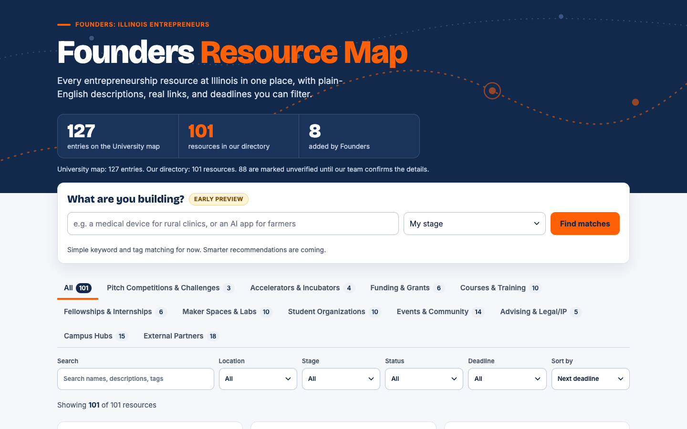
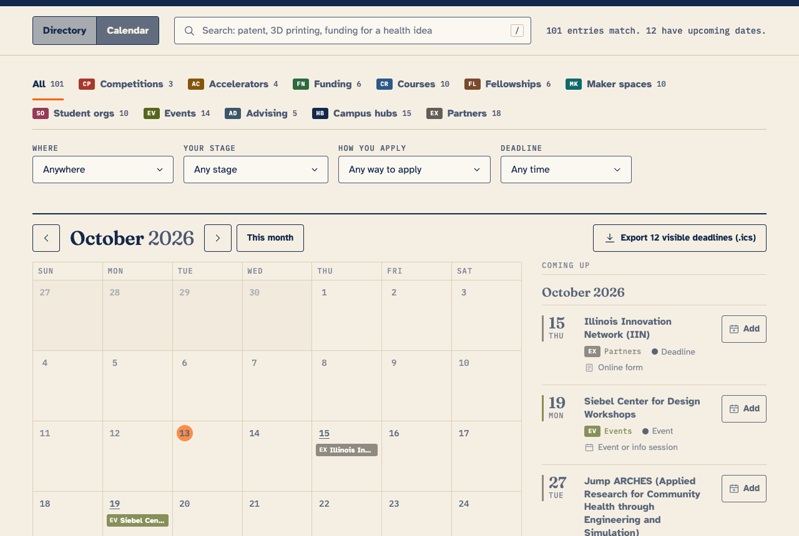
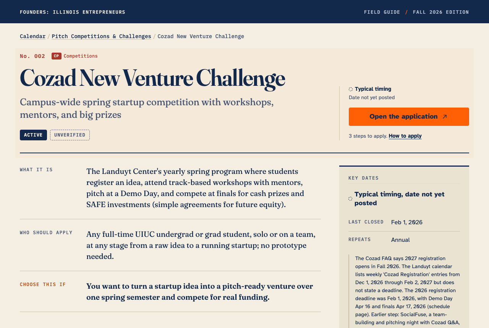
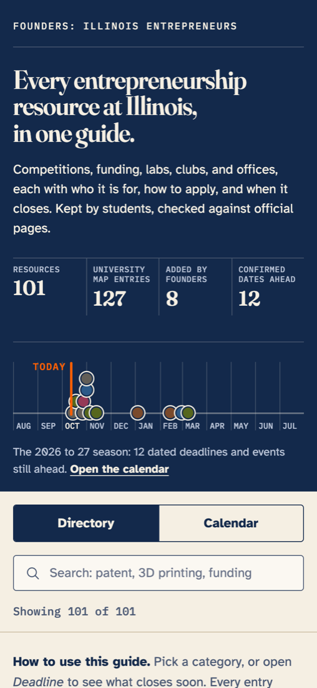

# Founders Field Guide

A student-built guide to entrepreneurship resources at the University of Illinois
Urbana-Champaign. It covers competitions, funding, labs, clubs, and offices. For each one it
says what it is, who should apply, how to apply, and when it closes. Built by the Founders:
Illinois Entrepreneurs team.

> Student-run project, not an official University of Illinois resource.



| Calendar | Resource page | Phone |
|---|---|---|
|  |  |  |

## Why this exists

The University's [Entrepreneurship Ecosystem Map](https://entrepreneurship.illinois.edu/about-our-ecosystem/entrepreneurship-ecosystem-map)
lists about 127 partners and programs as bare names. It has no descriptions, no links per
resource, no dates, no search, and it contains duplicates and stale entries. This guide turns
that list into one plain-English entry per resource, adds resources the map misses, and keeps
every date tied to an official source. See `notes/gap_analysis.md`.

**Current numbers (2026-10-13):**
- 127 map entries.
- 101 resources: 93 from the map after removing duplicates, plus 8 added by Founders.
- 12 confirmed upcoming deadlines and events.
- 60 resources with step-by-step apply instructions.
- 77 resources still marked unverified until a teammate checks them.

## What changed in round 2

Peer feedback said four things:
- Titles did not explain what things were.
- Deadlines were missing.
- The detail panel felt generated.
- Nobody could tell how to apply.

Round 2 responds with:
- **Plain-English summaries.** Every entry now has a tagline under its name, plus three
  summary rows: *What it is*, *Who should apply*, *Choose this if*.
- **How to apply.** Every entry has an application method and, where an official page
  describes them, up to three numbered steps and a direct apply link.
- **Deadline types.** Every deadline is typed Confirmed, Typical, Rolling, None published, or
  Unknown. Past cycles are recorded so teammates can see when things usually open.
- **A deadlines calendar** with the same filters as the directory, plus .ics export.
- **A real page for each resource** (linkable, works with Back), with a one-page print handout.
- **A new design.** The concept is a numbered field guide with a season strip across the
  academic year. See `notes/design_brief.md`.

The audit that set these priorities is in `notes/round2_audit.md`.

## Folder layout

```
README.md
data/
  raw_map_entries.csv          every entry exactly as listed on the map, with section path and canonical id
  resources.csv                source of truth: one row per resource, ready to import into Airtable
  resources.json               same data, generated for the site
  map_snapshot_2026-10-13.html saved copy of the University map used for extraction
notes/
  schema.md                    every field, its type, allowed values, an example, and what the validator enforces
  taxonomy.md                  categories, category codes, tags, stage, location
  round2_audit.md              what was missing before round 2, and the research priorities
  design_brief.md              references, principles, concepts, design system, critique loop
  gap_analysis.md              what the map has and lacks, what we added, what looks defunct
  to_confirm.md                checks a person must make, in batches of about 10 resources
scripts/
  extract_map.py               parses the map into raw_map_entries.csv
  validate.py                  checks the CSV and every URL, writes results into to_confirm.md
  build.py                     resources.csv -> resources.json + docs/index.html
  site/index.html, styles.css, app.js   the site source; build.py inlines them into one file
  test_site.cjs                headless browser tests and screenshots
docs/
  index.html                   the shareable site: one self-contained file
  screenshots/                 desktop, mobile, and print screenshots; critique/ holds before and after passes
```

## Open the site locally

Double-click `docs/index.html`. It works with no server and no build step, because the data,
CSS, and JS are all inside the file. Fonts load from Google Fonts when you are online, and the
page falls back to system fonts when you are not.

## Publish with GitHub Pages

1. Go to **Settings > Pages** on GitHub.
2. Under **Build and deployment**, choose **Deploy from a branch**, branch `main`, folder **`/docs`**. Save.
3. After a minute the site is live at `https://<org-or-user>.github.io/founders-resource-map/`.

## How the site works

**Directory.**
- Entries are grouped into numbered sections in guide order. You can also sort by soonest
  deadline or by name.
- Each row shows the name, tagline, "choose this if", deadline, and how to apply.
- Every resource keeps a permanent number (No. 001 and up), assigned in CSV row order. Add new
  rows at the end, so existing numbers never shift.

**Filters.** All of these filters combine with each other:
- Category tabs
- Search (plain words; "patent" or "3D printing" also match related tags)
- Where
- Your stage (choosing a stage also shows resources marked Any)
- How you apply
- Deadline

Every option shows how many entries it would return. Active filters appear as removable chips,
with a Clear all button. Filters live in the URL, so a filtered view can be shared as a link.

**Deadline filter.** It offers single-select options plus a custom date range. The ranges count
from today:

| Option | Shows |
|---|---|
| Next 7 days, 8 to 30, 31 to 60, 61 to 90, More than 90 days | entries with an upcoming `next_deadline` in that range |
| Rolling admissions | `deadline_type` Rolling |
| No deadline published | `deadline_type` None published |
| Date to be confirmed | no upcoming date, and the type is Typical or Unknown (or a Confirmed date has passed) |
| Recently closed (past 30 days) | the last deadline (`last_deadline`, or a passed `next_deadline`) fell in the past 30 days |

**Calendar.** Switch to it with the Directory | Calendar toggle. The same filters apply.
- **Month grid:** markers colored by category, each labeled with a two-letter code.
  Confirmed dates are solid. Typical dates are outlined and labeled "Typical, date not yet
  posted", and they appear on a day only when `next_deadline` is set and justified.
- **Agenda:** "Coming up", grouped by month, showing date, name, category, and how to apply.
  On a phone, the agenda is all you see.
- **Rolling and unscheduled:** every matching entry without an upcoming date, grouped by
  type, so nothing disappears.
- **.ics files:** use **Add** for any confirmed deadline, or **Export visible deadlines (.ics)**
  for everything the current filters show. Clicking a marker opens that resource, and Back
  returns to the same calendar view.

**Resource pages** live at `#/resource/<id>`. Each page has:
- breadcrumb, badges, summary rows
- how to apply (steps, apply button, contact)
- key dates
- details
- sources and verification
- up to three related resources

Empty rows are hidden. Printing a resource page gives a one-page handout.

## Edit the data, then regenerate the site

`data/resources.csv` is the source of truth. Never edit `resources.json` or `docs/index.html` by hand.

```bash
# 1. Edit data/resources.csv (a spreadsheet app or a text editor; keep UTF-8 and the header row)
# 2. Check it
python3 scripts/validate.py            # add --no-urls for a quick offline check
# 3. Rebuild the JSON and the site
python3 scripts/build.py
# 4. Optional: browser tests and fresh screenshots (needs Node)
npm i --no-save playwright && npx playwright install chromium
node scripts/test_site.cjs
```

The Python scripts use only the standard library (Python 3.9+). `validate.py` exits with an
error if the CSV breaks the schema: missing summary rows, a bad `application_method` or
`deadline_type`, a Confirmed deadline without a date or source, more than 3 apply steps, em
dashes, and so on. It also lists URLs that did not load in `notes/to_confirm.md`. Some sites
block scripts, so check those in a browser before changing anything.

The tests pin "today" with `?today=2026-10-13`. You can do the same in a browser
(`docs/index.html?today=2026-11-01`) to preview how the deadline filters will look on a future date.

To re-extract the University map: `python3 scripts/extract_map.py --live`.

## New fields (round 2)

The full definitions are in `notes/schema.md`.

| Field | What it holds |
|---|---|
| `tagline` | Plain-English label shown under the name, at most 90 characters |
| `what_it_is` | One concrete sentence |
| `who_should_apply` | One sentence naming the student type and stage |
| `choose_this_if` | One sentence starting "You want to" or "You are" |
| `application_method` | Online form, Email, Pitch submission, Info session or event, Course registration, Contact staff, Walk-in or open access, Not applicable, Unknown |
| `apply_steps` | Up to 3 steps separated by ` \| `, only from official pages |
| `apply_url` | The application or contact page, when it differs from `url` |
| `opens_date` | When applications open, if published |
| `deadline_type` | Confirmed, Typical, Rolling, None published, Unknown |
| `last_deadline` | The most recent past deadline (powers "Recently closed") |

`description` stays as a standalone 1 to 2 sentence summary for Airtable, the future website,
and Luma. The reasoning is in `schema.md`.

## Import into Airtable

The Airtable free plan allows 1,000 records per base and 5 editors, which is enough for this project.

1. Create a base and choose **Import > CSV file**, then pick `data/resources.csv`.
2. Set field types after import:

| Field type | Fields |
|---|---|
| **Single select** | `category`, `location`, `stage`, `status`, `recurrence`, `student_eligible`, `confidence`, `application_method`, `deadline_type` |
| **Multiple select** | `tags` (Airtable splits on commas, so first replace `;` with `,` in the tags column only, or import as text and split with an automation) |
| **Checkbox** | `on_university_map`, `needs_confirmation` |
| **Date (ISO format)** | `next_deadline`, `opens_date`, `last_deadline`, `last_verified` |
| **URL** | `url`, `apply_url` |
| **Email** | `contact_email` |
| **Long text** | `description`, `what_it_is`, `who_should_apply`, `choose_this_if`, `apply_steps`, `deadline_note`, `notes`, `source_urls` |
| Single line text | everything else, including `tagline` |

3. Make `name` the primary field. Keep `id` as a normal field and never change an existing id,
   because the site and future integrations (Luma, the larger website) key on it.
4. Create these views:
   - **By category:** grid grouped by `category`, sorted by `name`.
   - **Closing soon:** filter `next_deadline` is on or after today, sorted by `next_deadline`.
   - **Active only:** filter `status` = Active.
   - **Needs confirmation:** filter `needs_confirmation` is checked, grouped by `category`. This is the team's work queue.
   - **Missing application steps:** filter `apply_steps` is empty and `application_method` is not Not applicable or Walk-in or open access.
   - **Deadline calendar:** a Calendar view on `next_deadline`, colored by `deadline_type`.
5. To update the site from Airtable: **Download CSV** from the grid view (all fields, original
   column order), save it over `data/resources.csv`, and convert tags back to semicolons if you
   changed them. Then run `validate.py` and `build.py`.

## Data verification policy

A wrong deadline in front of students is worse than a blank one.

- **Never guess.** Deadlines, dates, costs, award amounts, eligibility, application steps, and contact info come only from an official page. If you cannot verify something, leave it blank, keep `needs_confirmation=TRUE`, and add a line to `notes/to_confirm.md` saying exactly what to check and where.
- **Deadline types.**
  - **Confirmed** means an official page shows that date for the upcoming cycle, and the page is in `source_urls`.
  - **Typical** means a documented pattern from past cycles, with the evidence in `deadline_note`. Typical dates are never placed on the calendar unless a specific date is justified.
- **Status** is `Active` only when an official page shows a current or upcoming cycle, or an ongoing service. If the last deadline passed and no new cycle is posted, status is `Unknown`. `Inactive` needs clear evidence the program ended.
- **Confidence:** High means an official page confirms it. Medium means a credible secondary source. Low means inferred.
- **last_verified** is the date a person checked the row.
- **Writing:** our own words, specific, no copied site text, and no em dashes.
- **The site shows uncertainty.** Unverified entries carry a marker in the list, and each resource page includes a "Needs confirmation" notice.

## Suggest or correct a resource

- **Teammates:**
  1. Take a batch in `notes/to_confirm.md` (about 10 resources each) and verify the items.
  2. Edit `data/resources.csv` (or Airtable). Put the evidence URL in `source_urls` and set `last_verified` to the day you checked.
  3. Run `validate.py` and `build.py`, then open a pull request.
- **New resource:**
  1. Add a row at the end of the CSV with a new lowercase slug `id`, `on_university_map=FALSE`, and the evidence in `source_urls`.
  2. Fill the summary rows, `application_method`, and `deadline_type`.
  3. Add a line to "Resources added by Founders" in `notes/gap_analysis.md`.
- **Anyone else:** every resource page has a "Suggest a correction" link, prefilled with the
  resource name, and the footer has "Suggest a resource". These links open a prefilled GitHub
  issue. To make them prefilled emails instead, set `CONFIG["corrections_email"]` in
  `scripts/build.py` to the team's shared inbox and rebuild.

## Disclaimer

This is a student-run project by Founders: Illinois Entrepreneurs. It is not an official
University of Illinois resource and is not endorsed by the University. Program details change,
so always confirm on the official site before applying.
